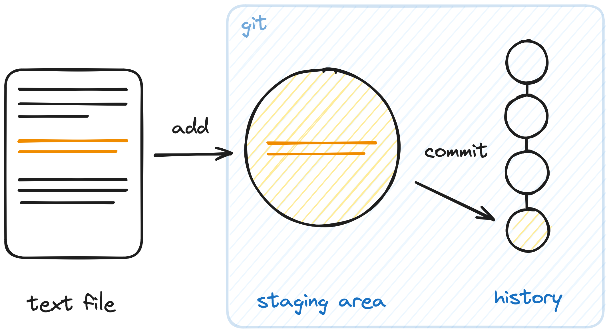
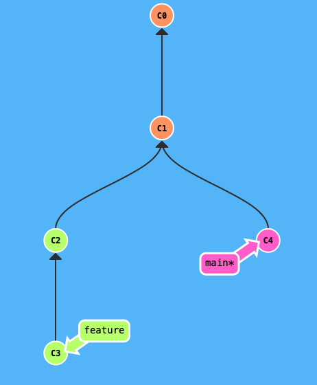
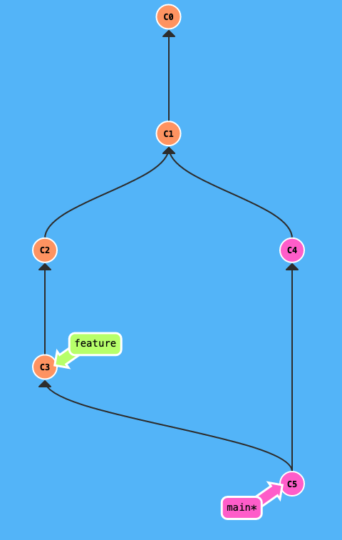
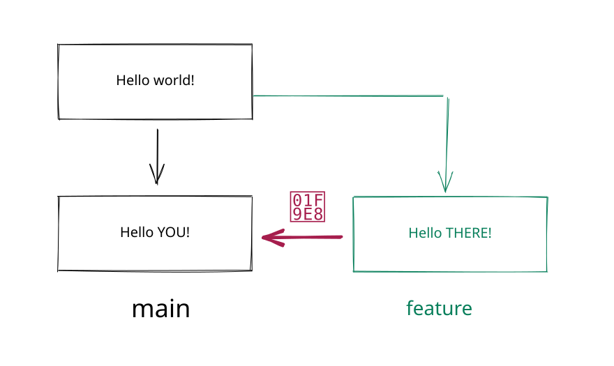
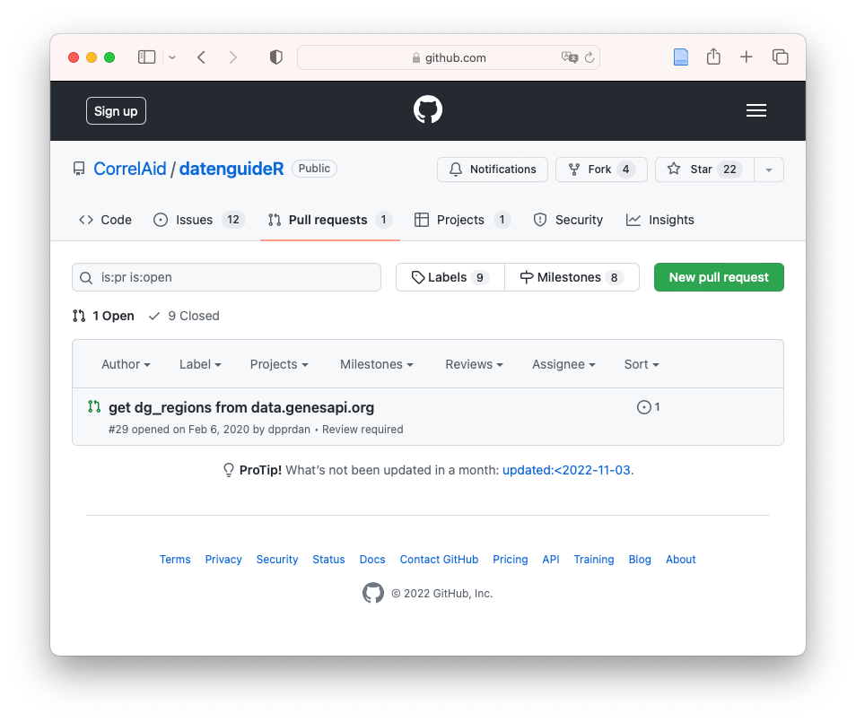

# Local `git` Basics

## The 3 Levels of Changes in `git`



## The 3 Levels of Changes in `git`


- When we first make a change it is *unstaged*
- Once we `add` the change to the staging area it is *staged*
- We can then `commit` all *staged* changes
- We can `restore` the committed version and remove *unstaged* changes

## The Essential Local Workflow

```bash
# Create a repository once
git init

# Inspect, stage, and save a change
git status
git add <file>
git commit -m "Describe the change"

# No need to remember all the command names
# git status will suggest many
git status
```

## Writing Good Commit Messages

- Write a short, meaningful summary of the change
- Start with a verb in the imperative mood
  - `Add data-cleaning pipeline`
  - `Fix missing-value handling in regression model`
- Keep unrelated changes in separate commits
- Add a longer explanation in the commit body when the *why* is not obvious

## `.gitignore`

::: {.nonincremental}

- Ignore files by adding patterns to `.gitignore`
- Reverse an ignored pattern with `!`
- `git` tracks *files*, not directories
- To retain an otherwise empty directory, use:

:::

```gitignore
# in dir/.gitignore
*
!.gitignore
```

# Demo: *Local `git`* in Vscode

# Branches and Merging

## What Are `git` Branches? 🌳

- Branches allow different versions of your code within one repository
- You can switch between branches and merge changes back into `main`
- The default branch used to be called `master`; many repositories now use
  `main`

## Illustration 🌲 {background-color="#5cbcfc"}



## Creating and Merging Branches

```bash
# Create a branch and switch to it
git checkout -b my-branch

# Switch back to the main branch
git checkout main

# Merge my-branch into the current branch
git merge my-branch
```

- `git merge <branch>` merges the named branch *into the branch you are on*
- Merging usually creates a merge commit

## Visual Example of Merging {background-color="#5cbcfc"}

:::: {.columns}

::: {.column width="50%"}

Before merging

{width=70%}

:::

::: {.column width="50%"}

After merging

{width=65%}

:::

::::

# Demo: *Branches* in Vscode

## Merge Conflicts

- A conflict occurs when `git` cannot decide how to combine changes
- They usually arise when two branches change the same part of a file
- Resolve every conflict, stage the resolution, then commit it
- Merge often to keep conflicts small and easier to resolve

## Merge Conflicts



## Practical: Rock-Paper-Scissors 🪨📜✂️ {background-color="black"}

1. Create a new directory, enter it, and initialize a git repository
2. Create a new file called `conflict.txt` with the following contents:

```text
Round 1

Round 2

Round 3

🏁
```
::: {.incremental}

3. Add and commit the file.
4. Create and check out a branch called `my-turn`.

:::

## Practical: Resolving the Conflict {background-color="black"}

::: {.incremental}

5. On `my-turn`, add your choice of rock, paper, or scissors for each round,
   then commit the change.
6. Check out `main`, add your own choices for each round, and commit them.
7. Merge `my-turn` into `main`: `git merge my-turn`

8. Explore the resulting conflict markers in `conflict.txt`.
9. For each round, keep both choices and add who won.
10. Stage the resolved file and commit the merge.

:::

## Feature Branches

- Work in a separate branch for each feature or fix
- Keep feature branches short-lived
- Merge or rebase regularly to incorporate current `main`
- Common names: `feat-xyz` or `<username>/feat-xyz`

# Collaboration with GitHub

## Remotes 📺

- A *remote* links your local repository to a hosted repository
- A remote also has branches
- The conventional default remote name is `origin`
- `git clone` creates the repository and links `origin` automatically

```bash
# Link an existing local repository to GitHub
git remote add origin git@github.com:OWNER/REPOSITORY.git
```

## Syncing Changes

You first `pull` the latest changes from the remote and then `push` your own
changes.


## Fetch, Pull, and Push

```bash
# Download remote changes without changing your branch
git fetch

# Fetch and merge the tracked remote branch
git pull

# Send commits on the tracked branch to the remote
git push

# Publish a new branch and set its upstream
git push -u origin my-branch
```

- Pull before pushing when teammates may have added changes
- Resolve and commit any resulting merge conflicts before pushing

# Pull Requests

## Pull / Merge Requests (PRs / MRs)

- A request to review and merge a branch's changes
- GitHub calls them *Pull Requests*; GitLab calls them *Merge Requests*
- PRs provide a place for discussion, review, automated checks, and merging

## A Typical Pull-Request Workflow

1. Create an issue describing the work.
2. Create and check out a short-lived feature branch.
3. Make focused commits and push the branch to GitHub.
4. Open a pull request against `main`.
5. Review, address feedback and checks, then merge the PR.

## Pull Requests: Overview



::: attribution
Repository: <https://github.com/CorrelAid/datenguideR>
:::

## Working Together Safely

- Pull frequently and push small, focused changes
- Keep branches short-lived to avoid merge conflicts
- Review changes before merging and let automated checks run

## Git Filters: Clean Jupyter Notebooks

- Filters transform file contents as they move between the working directory and `git`
- [`nbstripout`](https://github.com/kynan/nbstripout) removes cell output and
  metadata from Jupyter notebooks before they are committed

```bash
# Set up filter in current repository
nbstripout --install
```

- This keeps notebook diffs small and prevents large output cells from being
  committed accidentally

## Further Exploration 📚

- Practice branching and merging interactively:
  <https://learngitbranching.js.org/>
- You can use `worktrees` to check out multiple branches from one
  repository at the same time, each in its own directory
- Find practical guides at <https://github.com/git-guides>
- Recover from common mistakes with <https://ohshitgit.com/>

## *End of Refresher* 🎉 {background-color="black"}

:::{.r-fit-text}
Any Questions?
:::

[[🏡 Back to Overview]](./index.html)
